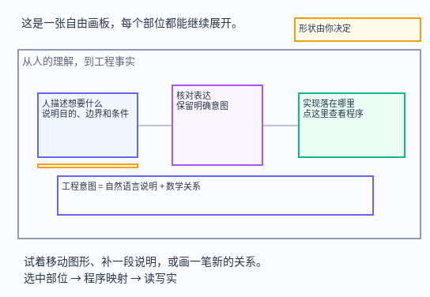

# dsh-anatomy · 自由工程画板

**自由二维工程画板：用自然语言与数学描述工程，每个部位都能关联实现，致力于层级信息抽象与强校验的人机共读与修改互动。**

当前版本 **0.11.0**：[更新说明与升级步骤](docs/RELEASE-0.11.0.md) · [更新记录](CHANGELOG.md)。

用自然语言和数学关系，在一张可自由绘制的二维画板上描述工程。点击任何图形、笔迹、文字或公式，可以查看和编辑这个部位的程序表达与源码关联。



<sub>上图为从画板数据生成的结构示意（非界面截图）：虚线框是分区，实心块是部位，箭头是部位之间的关系。</sub>

画板不预设工程必须长什么样，也不要求先拆成器官、系统或固定流程。图形位置由作者决定；需要表达数据流向或传递耗时时，用箭头、说明和数学关系显式写出来，不把画面距离冒充测量结果。当前不做三维适配。

## 直接试用

运行 `node examples/board-demo.mjs`，插件会生成画板、启动本地服务并请求浏览器打开。无桌面环境时打开工具返回的 `url`。示例用本插件的实际源码，演示人的意图、检查和程序映射。已有示例目录不会被覆盖，可传新的输出目录。

- **自由绘制**：矩形、椭圆、菱形、多边形、笔迹、直线、箭头、文字、公式、分区。支持移动、尺寸、旋转、填充、线条、字号、图层顺序和复制。
- **共同表达**：人读画面只展示自然语言与数学表达。每个图元的「程序映射」独立记录语言、程序片段、实现说明、源码文件与符号，可同时关联多个已有工程对象。
- **持续修改**：撤销/重做、多选、缩放、平移、本地草稿、画板导入/导出。保存修改直接写入工程专用目录，并选定供 AI 读取。
- **源码反查**：图元的直接源码关联纳入文件索引、源码指纹检查和机读摘要。未填写的程序映射保持空白，不自动编造实现。

## 已有工程怎么读

页面默认进入「工程导读」。先读工程目的，再用「开始阅读／上一步／下一步」定位到具体部位；每一步显示说明、数学关系、相连关系与实现依据。点击相连部位可以继续追踪；「查看程序映射」进入同一部位的代码和源码关联。导读中的顺序是阅读安排，不会冒充运行时调用顺序。

由 AI 阅读真实源码后，在 `board.reading` 写 `summary` 与 `steps`。每步包含已有图元 `element`、自然语言 `title` 与 `description`。没有专门导读时优先使用工程已记录的业务场景；再没有时显示部位索引，并明确尚无阅读主线。页面的「编辑工程导读」可修改说明、增删或调整步骤，和图元一起进入撤销、导出与版本化修改包。无效步骤引用或程序语言进入导读会被拒绝。

箭头和直线的 `text` 是关系名称，说明具体传递什么、在什么条件下使用或依赖什么。空名称先取所关联工程数据流的名称，再缺失则显示「关系待说明」，不猜测关系。名称单独排版并避开节点及其他标签。导读聚焦某部位时只显示相连线的名称，可勾选「全部连线名称」展开全图。

## 怎么使用画板

从左侧选工具后拖动绘图；文字和公式点击放置。多边形逐点点击，双击或回车结束。选择工具下点击图元，右侧切换「说明 · 数学」与「程序映射」。窄窗口通过「详情」展开面板。

从一个图形拖箭头到另一个图形，可以建立随动连线。按 Shift 点击可多选；空格拖动平移，滚轮缩放。常用快捷键：选择 V、画笔 P、矩形 R、文字 T、公式 M；撤销 Ctrl+Z、重做 Ctrl+Shift+Z 或 Ctrl+Y、复制 Ctrl+D、删除 Delete。数学栏支持 Unicode 数学符号和 LaTeX 数学记法，公式库提供实时排版预览；不执行公式或程序片段。

顶部「撤销」返回画板上一步修改，「重做」恢复刚撤销的修改。图形、说明、公式、程序映射、导读和自动排布共用同一条撤销记录；尚未失焦的字段修改也可用顶部按钮撤销。当前会话保留最近 60 步，刷新后不保证恢复撤销记录。撤销后做新修改会清空重做分支；这些操作不删除工程中已保存的历史版本。文本框内的快捷键由文本编辑器处理，需要返回整个画板的上一步时使用顶部按钮。

「保存修改」直接写入当前工程的 `anatomy-<slug>/edits/versions/`，每次保存留下不可变的完整版本，`edits/selected.json` 记录页面选定版本。「历史版本」可以命名下一次保存、浏览和选择旧版；有未保存内容时先自动存成新版本再切换。AI 用 `anatomy_selected_version` 读取选定版本，不需要用户下载或传文件。应用前核对 `selectionRevision` 与工程基线；另一页面切换或工程变化都会拒绝覆盖。保存意图不代表业务源码已实现，AI 仍需实施源码与验证。

浏览器草稿用于断线恢复。项目保存需要由插件的本地项目服务打开；普通静态服务器或独立 HTML 无法自行写入工程，页面明确报告未连接并保留草稿。「导出画板」仍可作为可选的文件交换功能。生成时默认自动撑开文字、公式并避让图形和分区；页面「自动排布」可再次排布并撤销，`board.layout.mode = "manual"` 保留自由绘画位置。

## 公式库与手写识别

左侧「公式库」提供 46 个可编辑模板：分式、根式、上下标、分段函数、方程组、求和、积分、矩阵、概率、集合逻辑和常见工程关系。模板插入编辑框的光标处，已有输入保留；继续编辑并预览确认后才放入画板。排版库随页面内嵌，离线打开也可使用；采用 [KaTeX 的 MathML 输出](https://katex.org/docs/options)，不加载远程字体或执行公式。

同一部位可以保存多条数学表达。选中部位打开公式库时，默认「追加数学表达」；原有公式继续保留。要修改已有公式，点击该条的「编辑这条表达」，或在公式库选择编辑及对应条目；「新建独立公式」则创建可单独选择、关联源码的图元。右侧「说明 · 数学」逐条显示编辑框和预览，可分别编辑或删除。各条表达都会进入画板、工程导读、机读摘要和项目保存，原部位的程序映射与源码关联保留。

左侧「识别」打开手写面板，支持鼠标、触控笔和触摸输入，也可先多选画板中的笔迹再识别。选择「中文说明」或「数学公式」，书写、识别、校对，然后确认新增图元或写入选中部位。数学模式可追加到当前部位、编辑明确选定的一条表达，或新建独立公式；默认追加会保留其他公式。每条表达的「继续手写」可恢复其笔迹，中文说明与数学表达分别保存笔迹。中文建议每次写一行；数学一次写一条完整公式。连接状态在面板打开时自动更新，也可点击「重新连接」。未确认的笔迹与校对结果会暂存在当前浏览器，关闭面板或刷新后可恢复。原笔迹不会被自动删除，确认后的结果和程序映射可一起保存、撤销。

手写识别通过本机 Python 服务完成，分别使用 [PP-OCRv5 中文识别](https://www.paddleocr.ai/v3.0.0/en/version3.x/algorithm/PP-OCRv5/PP-OCRv5.html) 与 [PP-FormulaNet 公式识别](https://www.paddleocr.ai/v3.1.1/en/version3.x/module_usage/formula_recognition.html)。识别是候选结果，复杂笔迹、上下标和汉字仍需校对。

调用 `anatomy_render` 时默认自动启动或复用本地服务，并请求系统浏览器打开返回的 `url`。网页先打开，中文与公式模型在后台准备，手写面板显示实际加载状态。同一画板重复生成复用同一服务；默认端口 8767 被其他页面占用时自动选择空闲端口，不会关闭已有服务。自定义输出文件名也支持。

首次使用需要安装 Python 和可选识别依赖（不会自动修改 Python 环境）：

```bash
python3 -m pip install -r scripts/requirements-ocr.txt
```

依赖建议装在独立 Python 环境，并把插件配置的 `pythonPath` 设为该环境的 Python 可执行文件路径。首次识别需要下载公开模型权重；之后从本地缓存加载。依赖缺失或加载失败时，画板仍可打开，面板会显示原因；修好依赖后重试识别。

- `anatomy_render({ body: 'project', open: false })`：启动服务，只返回地址。
- `anatomy_render({ body: 'project', serve: false })`：只生成 HTML。
- 插件配置 `autoServe: false` / `autoOpen: false` 可更改默认行为；单次工具参数优先。
- 返回的 `service.status` 区分 `starting`、`ready`、`unavailable`、`disabled`，`browser.status: requested` 仅表示已发出打开请求。无法自动打开时使用返回的 `url`。

直接双击独立 HTML 或使用普通静态服务器时，绘图与公式可用，但浏览器不能自行启动 Python。需要手动启动时，从插件目录运行 `npm run serve -- --dir anatomy-freeboard --port 8767 --warmup`，或用 `--file /路径/自定义画板.html` 指定文件，再打开服务打印的地址。

服务只监听本机回环地址，仅提供指定画板、项目版本和识别接口；不会开放整个工程目录。识别请求只在本机处理，服务端不保存笔迹图像；未确认的草稿仍由浏览器暂存。服务独立于生成命令运行，关闭网页不会停止它。画板目录内的 `.anatomy-runtime/` 保存地址、进程标识和日志，勿提交版本库；要停止服务，可核实返回的 `service.pid` 对应本画板后结束该进程。

`npm run test:ocr` 测试服务输入校验、中文/公式分流、模型结果解析和本地访问边界；`python3 test/recognition-smoke.py http://127.0.0.1:8767` 可用合成笔迹检查实际模型对“中文”和带上标公式的识别通路；它不代表复杂手写的准确率。

## Codex 接口

插件包含 Codex 兼容清单 `.codex-plugin/plugin.json`、技能与标准 stdio MCP，沿用全部严格校验工具，无需 DSH 宿主或 OpenAI API 密钥。Node.js 18 及以上用于 MCP 和项目保存；Python 用于本地 HTTP 服务，可选识别依赖缺失不影响项目版本保存。本地安装：

```bash
codex plugin marketplace add /绝对路径/dsh-anatomy
codex plugin add anatomy@anatomy-local
```

重新加载插件或在新对话启用 Anatomy。也可单独注册 MCP：`codex mcp add anatomy -- node /绝对路径/dsh-anatomy/scripts/mcp-server.mjs`。有当前画板网页上下文时，`anatomy_selected_version({ url })` 根据该本地服务自动定位工程，用户无需提供文件路径。否则技能按当前对话工程定位 `anatomy-*/` 并给工具传 `dir`；有多个工程时不能盲选最近保存的另一项目。初始化与工具发现遵循 [MCP stdio 规范](https://modelcontextprotocol.io/specification/2025-11-25/basic/transports)，打包和安装遵循 [Codex 插件文档](https://developers.openai.com/plugins/build/plugins)。

保存不会自行向聊天发送消息或触发 AI 改代码。在对话要求 Anatomy 按页面选定版本实现时，AI 读取共享选择文件、核对意图，再执行源码修改与测试。严格结构、源码证据和数值规则门禁继续适用；任意自然语言与公式的完整语义正确性仍需 AI 和真实测试核对。

## AI 接入

```javascript
anatomy_init({ repo: '/工程目录', body: 'project', title: '订单处理', oneline: '把提交的订单转为可交付的结果。' })
anatomy_board({ body: 'project', board: {
  version: 1,
  elements: [{
    id: 'accept-order', type: 'rect', x: 80, y: 120, width: 280, height: 160,
    text: '接收订单并检查交付条件', math: '可接受数量 ≥ 1',
    fill: '#eff6ff', stroke: '#6366f1',
    implementation: { language: 'JavaScript', code: 'validateOrder(order)', note: '填写经过阅读确认的实际实现。' },
    anchors: [{ file: 'src/order.js', symbol: 'validateOrder', role: 'implementation', reason: '检查订单的接受条件' }]
  }]
} })
anatomy_render({ body: 'project' })
anatomy_board({ body: 'project', element: 'accept-order' }) // 读取所点部位的程序映射
```

示例中的文件与符号必须替换为工程实际存在的对象。`anatomy_board` 保存整张画板，先读当前值再修改，保留其他图元、源码基线与扩展字段。浏览器修改包用 `baseHash` 检查是否过期；不能改哈希或强制覆盖来消除意图冲突。

画板在 `body.json.board`。每个图元具有稳定 `id`、`type`、位置与宽高；笔迹与多边形用 `points` 表示按宽高缩放的相对坐标。直线和箭头可用 `from`、`to` 关联图元。`targets` 可关联既有 `organ` / `flow`，但自由画板无需它们。线条连接代表作者绘制的关系，不会自动变成程序调用或数据依赖。

图元原有的 `math` 保存主表达；可选的 `mathExpressions` 数组保存附加表达，每项含稳定的 `id` 与数学内容 `value`，并可保留该条笔迹和扩展字段。追加时不要覆盖 `math`，编辑时只更新目标表达；读取、保存和核对意图时应包含全部表达。旧画板无需迁移即可继续读取。

## 修改与校验

AI 开工先调用 `anatomy_selected_version({ dir })`，读取页面选定完整版本，用返回的 `selectionRevision` 应用。尚未采用项目保存的旧页面才检查 `anatomy_pending_edits`。自然语言和数学表达是人的意图，程序映射和源码关联是下层落实依据。改完实际实现后运行相关测试，核对意图、数学关系和边界，再用 `reviewSources: true` 更新所复核图元的源码基线。

写入检查图元结构、有限几何值、唯一标识、有效端点与工程引用，并检查源码文件、符号和内容变化。程序语言进入人读说明会被拒绝；自动识别基于语法线索，不能代替作者复核。普通写入保留原源码基线，不能用重新保存来掩盖源码变化。

保存了意图不等于完成了实现。任意自然语言、自由图形和数学表达不会被自动证明。已有结构模型的 `rules` 与 `anatomy_verify` 继续支持绑定版本的数值证据检查；自由图元当前的程序映射是待 AI 阅读、实施与验证的工程描述。没有实测证据时不能声称实现满足要求。

## 工具与文件

共 23 个工具。自由画板主要使用 `anatomy_init`、`anatomy_board`、`anatomy_render`、`anatomy_check`、`anatomy_show`、`anatomy_map`、`anatomy_digest`。工程协作用 `anatomy_selected_version`、`anatomy_mapping`、`anatomy_impact`、`anatomy_apply_edits`、`anatomy_pending_edits`、`anatomy_history`、`anatomy_revert`。

既有结构模型继续支持 `anatomy_scaffold`、`anatomy_organ_put`、`anatomy_flow_put`、`anatomy_remove`、`anatomy_brief`、`anatomy_scenario_put`、`anatomy_policy`、`anatomy_activate`、`anatomy_verify`。旧工程首次渲染时自动转换为可自由排布的图元，保留原工程对象的关联；保存画板后沿用作者布局。

工程目录保存 `body.json`、可选的 `organs/` 与 `flows.json`、`anatomy.html`、`receipt.json`、`MAP.md`、`DIGEST.md`、`edits/` 和历史记录。画板数据应随工程一起管理。

## 安装

插件目录与本仓库同级放置即可（DSH bundle 层）：

```yaml
# cordis.patch.yml 已随包提供
- insert:
    - id: dsh-anatomy
      name: '@dsh-external/dsh-anatomy'
      config: { rootDir: ., lang: zh }
```

在 DSH profile 里加一条依赖并把它放进 bundles：

```json
{
  "dependencies": { "@dsh-external/dsh-anatomy": "link:/path/to/dsh-anatomy" },
  "dsh": { "profile": { "bundles": ["@dsh-external/dsh-anatomy"] } }
}
```

配置项：`rootDir`（解剖体存放根目录，默认 `.`）、`lang`（`zh` | `en`，默认 `zh`）、`digestFile`（默认 `DIGEST.md`）。

## 开发与参考

`npm test` 运行工具端到端、映射与验证、自由画板数据和交互事件测试，并保留旧渲染器的兼容性回归。

- [作者技能](skills/anatomy-authoring/SKILL.md)
- [自由画板示例](examples/board-demo.mjs)
- [可选结构模型与验证参考](docs/structured-model.md)

## 许可证

本插件代码采用 **MIT** 许可证，全文见 [LICENSE](LICENSE)。

内置的公式排版引擎 KaTeX 以 `lib/vendor/katex.cjs` 形式随包提供，同为 MIT，许可证见 [lib/vendor/KATEX-LICENSE](lib/vendor/KATEX-LICENSE)。

手写识别所依赖的本地服务与模型不随仓库分发（首次使用时按上文自行安装），其许可证随该依赖自身提供。
